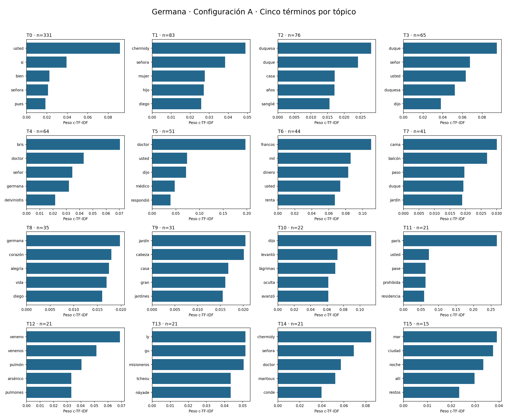
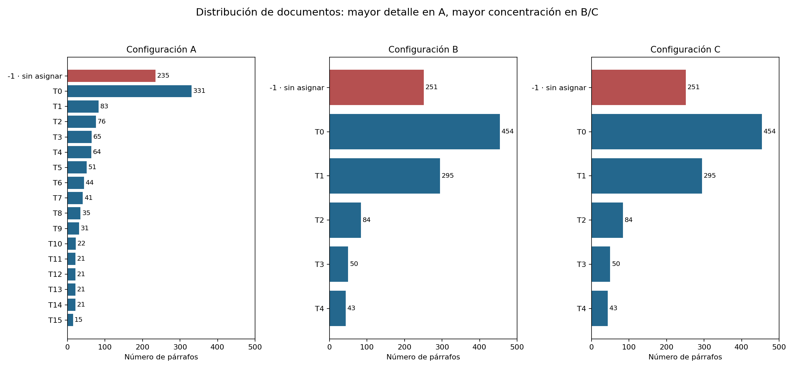
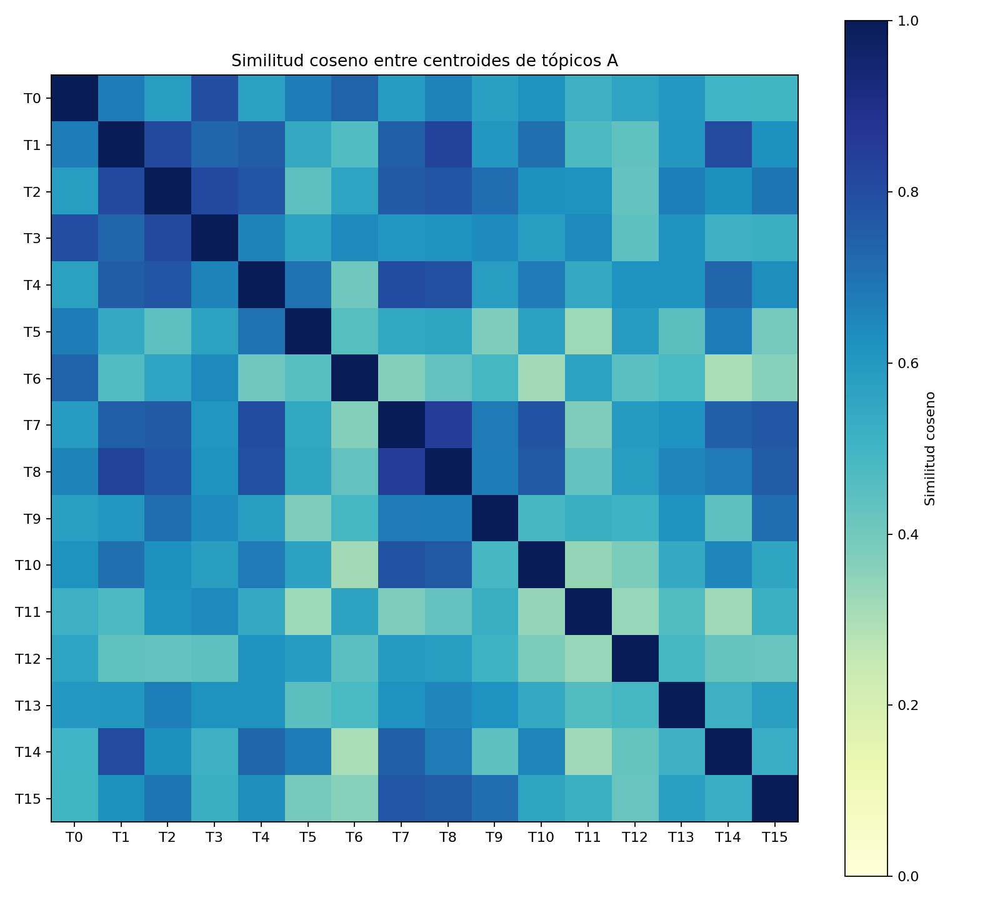

# Análisis de Germana con BERTopic

Se comparan las tres configuraciones ya ajustadas, sin modificar las stopwords, los embeddings ni las asignaciones. No se ejecuta el bonus ni se llama a una API de LLM. Los nombres y juicios cualitativos son una interpretación asistida por Codex, declarada como uso de IA; no representan una comparación BERTopic vs. LLM ni una evaluación independiente.

La configuración A se toma como principal por recuperar temas concretos que B/C reúnen en un grupo amplio. Esta selección es cualitativa, no un resultado de validación supervisada. Se revisan tres representantes automáticos por tópico en A/B, los mismos ejemplos de B para C, dos párrafos adicionales por tópico de A elegidos con semilla 17 y diez outliers de A con semilla 42. No se afirma haber leído y validado los 1,177 párrafos individualmente. Las categorías de coherencia son juicios orientativos, no métricas calculadas.

## Comparación de configuraciones

| Configuración | Tópicos | Outliers | % outliers | Diversidad top-10 |
|---|---:|---:|---:|---:|
| A | 16 | 235 | 19.97 | 0.7625 |
| B | 5 | 251 | 21.33 | 0.7400 |
| C | 5 | 251 | 21.33 | 0.7800 |

## Tabla de tópicos A

| ID | Segmentos | % corpus | Nombre | Coherencia cualitativa |
|---|---:|---:|---|---|
| -1 | 235 | 19.97 | Sin asignación temática | No evaluable |
| 0 | 331 | 28.12 | Diálogos de afecto, reproche y negociación | Baja |
| 1 | 83 | 7.05 | Chermidy, maternidad y legitimidad de los Villanera | Media-alta |
| 2 | 76 | 6.46 | Decadencia económica y social de la familia del duque | Media |
| 3 | 65 | 5.52 | Tratos y fórmulas de cortesía dirigidos al duque | Baja |
| 4 | 64 | 5.44 | Enfermedad de Germana y cuidados médicos | Media-alta |
| 5 | 51 | 4.33 | Conversaciones con el doctor | Media-baja |
| 6 | 44 | 3.74 | Dinero, rentas y especulación | Alta |
| 7 | 41 | 3.48 | Escenas de alcoba, angustia y muerte | Media |
| 8 | 35 | 2.97 | Vida afectiva, sufrimiento y retratos psicológicos | Media-baja |
| 9 | 31 | 2.63 | Descripción de espacios, ciudades y apariencia | Media-baja |
| 10 | 22 | 1.87 | Gestos, entradas y acotaciones narrativas | Baja |
| 11 | 21 | 1.78 | París: residencia, desplazamientos y referencias urbanas | Baja |
| 12 | 21 | 1.78 | Venenos, toxicología y proyecto de envenenamiento | Alta |
| 13 | 21 | 1.78 | Cartas de China y conflicto de la Náyade | Alta |
| 14 | 21 | 1.78 | Intrigas de Chermidy con Mantoux y le Tas | Media |
| 15 | 15 | 1.27 | Paisajes, viajes y paseos junto al mar | Media |

**T-1: Sin asignación temática.** Documentos que no forman parte de un grupo suficientemente denso; no constituyen un tema.

**T0: Diálogos de afecto, reproche y negociación.** Los ejemplos incluyen confesión amorosa y conflicto familiar, pero también réplicas muy breves. El predominio de usted, si y bien y la proporción de diálogo sugieren un grupo de forma discursiva más que un tema único.

**T1: Chermidy, maternidad y legitimidad de los Villanera.** Confluyen el hijo de Chermidy, el apellido y herencia, y las obligaciones afectivas de don Diego. Comparte personajes y conflictos con 0 y 14.

**T2: Decadencia económica y social de la familia del duque.** Los ejemplos describen crédito, pobreza de la duquesa y derroche del duque. Otros documentos se relacionan por personajes o ambiente social; no es un tema económico puro.

**T3: Tratos y fórmulas de cortesía dirigidos al duque.** La petición de matrimonio es interpretable, pero réplicas como A elección de usted, señor duque no permiten inferir un asunto único. Agrupa interlocutores y fórmulas de tratamiento.

**T4: Enfermedad de Germana y cuidados médicos.** Los ejemplos sobre Le Bris, Delviniotis y el tratamiento con yodo forman un núcleo claro. Algunos miembros hablan de enfermedad o del doctor sin describir tratamientos.

**T5: Conversaciones con el doctor.** El destinatario doctor une las intervenciones, aunque unas versan sobre medicina y otras sobre fortuna o despedidas. No debe confundirse con un segundo tema clínico homogéneo.

**T6: Dinero, rentas y especulación.** Francos, renta, fortuna y Bolsa coinciden con los ejemplos. Es uno de los grupos con tema más reconocible, aunque los dos ejemplos sobre cincuenta mil francos son casi duplicados.

**T7: Escenas de alcoba, angustia y muerte.** Balcón, cama, gestos y movimientos unen escenas de Germana enferma y del desenlace de Chermidy. La conexión es espacial y narrativa; no todo el grupo describe el mismo suceso.

**T8: Vida afectiva, sufrimiento y retratos psicológicos.** Reúne dolor materno, admiración por Germana y caracterización de Chermidy. El vocabulario emocional tiene sentido, pero el grupo abarca personajes y situaciones diferentes.

**T9: Descripción de espacios, ciudades y apariencia.** Los ejemplos describen Corfú, calles y vestimenta de la duquesa; la muestra adicional incluye jardines y edificios. Hay afinidad descriptiva, pero poca unidad temática estricta.

**T10: Gestos, entradas y acotaciones narrativas.** Son movimientos, miradas y frases introductorias de intervenciones. Lágrimas, levantó y dijo no definen un asunto; el modelo capta una función narrativa.

**T11: París: residencia, desplazamientos y referencias urbanas.** Hay restricciones de residencia de expresidiarios, pero también la apertura descriptiva de la novela y el regreso del médico a París. La coincidencia geográfica no justifica llamarlo tema policial homogéneo.

**T12: Venenos, toxicología y proyecto de envenenamiento.** Los ejemplos comparten venenos, arsénico y discusión de su detección, vinculados a la intriga. Se interpretan exclusivamente como contenido de ficción, sin validar sus afirmaciones científicas.

**T13: Cartas de China y conflicto de la Náyade.** Los ejemplos relatan los misioneros, Gu-Ly y la represalia naval. Es un episodio distintivo; los nombres propios ayudan a separarlo del conflicto doméstico. El relato expresa la perspectiva y prejuicios del narrador, no hechos históricos verificados.

**T14: Intrigas de Chermidy con Mantoux y le Tas.** Los ejemplos comparten la conspiración y los personajes, pero incluyen preparativos y transiciones. Se solapa con maternidad y con venenos sin reducirse a ninguno de ellos.

**T15: Paisajes, viajes y paseos junto al mar.** Pompeya, Nápoles y los paseos costeros comparten ambiente y descripción. Puede considerarse un tema de escenario; no describe una única localización y está en el tamaño mínimo de A.

## Tabla de tópicos B

| ID | Segmentos | % corpus | Nombre | Coherencia cualitativa |
|---|---:|---:|---|---|
| -1 | 251 | 21.33 | Sin asignación temática | No evaluable |
| 0 | 454 | 38.57 | Narración familiar, enfermedad e intriga (grupo heterogéneo) | Baja |
| 1 | 295 | 25.06 | Diálogos de amor y conflicto familiar | Baja |
| 2 | 84 | 7.14 | Conversaciones sobre el duque y París | Baja |
| 3 | 50 | 4.25 | Intercambios con el doctor | Media-baja |
| 4 | 43 | 3.65 | Dinero, rentas y fortuna | Alta |

**T-1: Sin asignación temática.** Ruido del agrupamiento; se mantiene sin reasignar.

**T0: Narración familiar, enfermedad e intriga (grupo heterogéneo).** Mezcla derroche del duque, enfermedad de Germana, maternidad y otros episodios. Su gran tamaño oculta temas que A distingue.

**T1: Diálogos de amor y conflicto familiar.** Contiene declaraciones amorosas y reproches familiares; también concentra el estilo dialogado y fórmulas frecuentes.

**T2: Conversaciones sobre el duque y París.** Se reúnen alusiones al duque y a París; no constituye un asunto narrativo único.

**T3: Intercambios con el doctor.** Predomina el interlocutor; los asuntos incluyen medicina y conversación social.

**T4: Dinero, rentas y fortuna.** La correspondencia de términos y ejemplos sustenta un tema económico reconocible.

## Tabla de tópicos C

| ID | Segmentos | % corpus | Nombre | Coherencia cualitativa |
|---|---:|---:|---|---|
| -1 | 251 | 21.33 | Sin asignación temática | No evaluable |
| 0 | 454 | 38.57 | Narración familiar, enfermedad e intriga (grupo heterogéneo) | Baja |
| 1 | 295 | 25.06 | Diálogos de amor y conflicto familiar | Baja |
| 2 | 84 | 7.14 | Conversaciones sobre el duque y París | Baja |
| 3 | 50 | 4.25 | Intercambios con el doctor | Media-baja |
| 4 | 43 | 3.65 | Dinero, rentas y fortuna | Alta |

**T-1: Sin asignación temática.** Ruido del agrupamiento; se mantiene sin reasignar.

**T0: Narración familiar, enfermedad e intriga (grupo heterogéneo).** Mezcla derroche del duque, enfermedad de Germana, maternidad y otros episodios. Su gran tamaño oculta temas que A distingue.

**T1: Diálogos de amor y conflicto familiar.** Contiene declaraciones amorosas y reproches familiares; también concentra el estilo dialogado y fórmulas frecuentes.

**T2: Conversaciones sobre el duque y París.** Se reúnen alusiones al duque y a París; no constituye un asunto narrativo único.

**T3: Intercambios con el doctor.** Predomina el interlocutor; los asuntos incluyen medicina y conversación social.

**T4: Dinero, rentas y fortuna.** La correspondencia de términos y ejemplos sustenta un tema económico reconocible.

Los tres párrafos completos por tópico están en el [anexo de ejemplos](anexo_ejemplos.md).

## Visualización 1: palabras representativas de A

Las barras corresponden a pesos c-TF-IDF, no a probabilidades. Los tópicos 6 (francos, renta), 12 (venenos) y 13 (misioneros, nombres de China) permiten identificar asuntos concretos. En 0, 3 y 5 predominan tratamientos y expresiones del diálogo: es evidencia de una representación menos específica. Las barras ayudan a describir los grupos, pero por sí solas no demuestran coherencia; se contrastan con los ejemplos.

## Visualización 2: tamaño de los grupos y outliers

A produce 16 tópicos, pero su mayor grupo (0) contiene 331 párrafos: 28.12 % del corpus. En B y C el grupo 0 contiene 454: 38.57 %. Los grupos 0 y 1 de B/C suman 749 párrafos, 63.64 % del corpus, lo que evidencia una concentración en dos categorías muy amplias. A conserva mayor detalle; eso no convierte todos sus grupos pequeños en temas válidos. Los outliers suben de 235 (19.97 %) a 251 (21.33 %).

## Visualización 3: similitud entre centroides de A

Se promedian los embeddings originales de los documentos de cada tópico y se calcula el coseno entre esos centroides; no se usa la proyección de UMAP. Valores altos indican proximidad semántica media y no prueban equivalencia ni coherencia interna. La relación más alta aparece entre 7 (escenas de alcoba) y 8 (vida afectiva), aproximadamente 0.845; entre 1 (familia/legitimidad) y 8 es 0.832. Esto concuerda con el solapamiento entre enfermedad, emociones e intriga. No hay un umbral universal para decidir fusiones a partir de este gráfico.

## Comparación, outliers y límites

Se elige A como configuración principal para el análisis, con reservas. En B, 62 de los 64 documentos del tópico médico A4 y los 21 de A13 (China) pasan al grupo B0: la reducción de detalle mezcla episodios distintos. Los IDs no corresponden entre modelos: A0 se compara principalmente con B1, no con B0. La tabla de transición registra estas correspondencias sin suponer equivalencia por número.

C conserva exactamente las asignaciones de B. Los bigramas hacen aparecer expresiones como señora chermidy y señor duque, pero también doctor dijo; no se observa una mejora concluyente de coherencia temática. La diversidad top-10 pasa de 0.74 en B a 0.78 en C; esto mide variedad léxica, no coherencia. La de A es 0.7625 y no basta para ordenar la calidad de los modelos.

Los outliers se mantienen sin reasignar y sin descartarlos del análisis: 235/1177 en A y 251/1177 en B/C. La muestra de A incluye transiciones, conversaciones y descripciones que sí tienen sentido literario. La mediana de longitud de los outliers es 32 palabras, frente a 27 en los asignados: su condición no se explica solamente por ser demasiado breves. No se ejecuta reduce_outliers, porque forzar una pertenencia podría ocultar ambigüedades. Los conteos describen cobertura del modelo, no calidad del texto.

El 93.66 % de A0 empieza por --, mientras que A1 contiene un 15.66 % de inicios de diálogo. La prueba es un indicador simple de formato y no detecta todos los discursos directos. Sugiere que MiniLM y el agrupamiento distinguen estilo narrativo además de asuntos. Se conservaron las stopwords y configuraciones originales para evitar cambiar el experimento después de ver sus resultados.

Los representantes automáticos no prueban homogeneidad de todo un grupo. En A6 los dos primeros ejemplos son casi duplicados, aunque no son duplicados exactos: la redundancia puede reforzar artificialmente su aparente coherencia. Los promedios de embeddings de fragmentos conservan más contenido de los párrafos largos, pero pueden diluir asuntos distintos. Un solo libro comparte personajes y estilo, por lo que sus temas se solapan más que en una colección de noticias independientes.

Esta es una exploración de una sola semilla. No se midió estabilidad entre semillas ni coherencia con anotaciones humanas externas. Cambiar conjuntamente min_cluster_size y min_samples entre A y B no permite atribuir por separado sus efectos. No se presentan tiempos de ejecución como comparación de rendimiento, porque el primer ajuste puede incluir compilación y C solo actualiza la representación.

Conclusión: el modelo identifica núcleos reconocibles (dinero, atención médica, venenos y China) junto a categorías de interlocutor, escenario o estilo. A conserva mejor esos núcleos en esta comparación; sus 16 grupos no deben presentarse como 16 temas literarios igualmente válidos. Los nombres asignados describen la evidencia y señalan los grupos débiles.

## Fuentes y declaración de IA

- Corpus y edición digital: https://www.gutenberg.org/ebooks/29640
- Modelo de embeddings: https://huggingface.co/sentence-transformers/paraphrase-multilingual-MiniLM-L12-v2
- BERTopic: https://arxiv.org/abs/2203.05794
- Documentación de parámetros: https://maartengr.github.io/BERTopic/getting_started/parameter%20tuning/parametertuning.html
- Resultados locales: notebooks 01 y 02, topic_info.csv, ejemplos_representativos.csv, asignaciones.csv y metadatos.json.

Se utilizó Codex (OpenAI), el 25 de octubre de 2026, para implementar el análisis, proponer nombres de tópicos, revisar ejemplos y redactar la discusión. Los nombres son etiquetas interpretativas asistidas por IA; no son clases verdaderas ni una evaluación independiente. No se realizó el bonus, ninguna comparación con un LLM ni llamadas a una API de pago. La versión concreta del modelo de Codex no se registró. Las versiones de las librerías y la revisión exacta de MiniLM están registradas en los metadatos previos y requirements-lock.txt.

